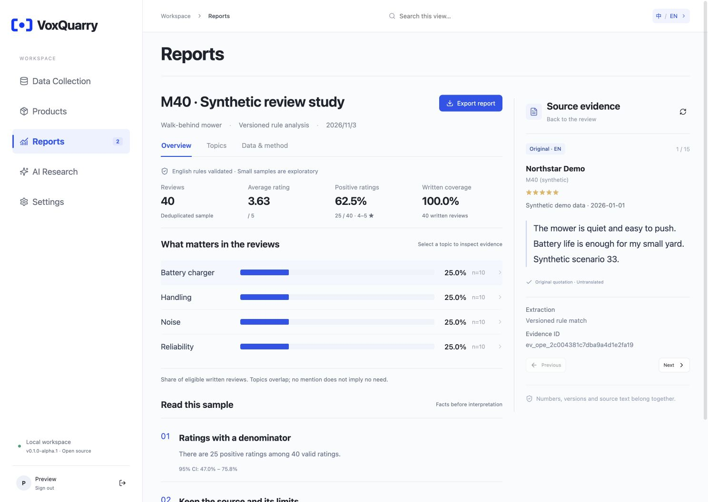

<p align="center"></p>

# VoxQuarry

**From reviews to evidence.** A self-hosted, bilingual workbench for collecting product reviews, maintaining a product catalog, generating reproducible reports, and researching with cited AI answers.

[简体中文](README.zh-CN.md) · [Quick start](#quick-start) · [Architecture](docs/architecture.md) · [Configuration](docs/configuration.md) · [Release notes](docs/releases/v0.1.0-alpha.1.md)



VoxQuarry keeps the denominator, source version and original review next to the conclusion. Deterministic reports work without a model key. AI research uses your configured model and rechecks source citations before saving an answer.

## What is included

| Module | First-release capability |
|---|---|
| Data Collection | Public-review adapters, bounded Walmart/Home Depot sampling, JSON import, attempts, deduplication and completeness records |
| Products | Category, brand and model records, structured specifications, provenance, review state and APIs |
| Reports | Versioned English rule packs, metrics with numerators/denominators, topic analysis, immutable snapshots, original evidence and Markdown/JSON export |
| AI Research | Saved private sessions, report discovery, tool-backed research, Markdown answers, inspectable citations and run steps; bring your own model |
| Settings | Local account, language controls, model/runtime status and repeatable synthetic demo |

English and Simplified Chinese interfaces, documentation and report summaries are included. Research response language can be chosen independently of the interface; explicit instructions in a question take priority. Switching the interface does not translate source quotations or rewrite prior answers.

**Alpha scope:** deterministic source-language coverage is English. Chinese source reviews can be retained, but cannot enter those English-only rule reports. Rule packs currently focus on outdoor power equipment and related product categories; they are not universal sentiment models. Small samples are marked exploratory. Partial source coverage remains visible.

## Quick start

Requirements: Python 3.11, Node.js 22, npm, Git and a macOS or Linux machine. The full application runs locally; a static site alone cannot host its APIs.

```sh
git clone https://github.com/ankeyao-lab/voxquarry.git
cd voxquarry
make install
make start
```

Open **http://127.0.0.1:18763** and create your first administrator account. In Reports, choose **Load synthetic demo**. It creates a fictional product, 40 fictional English reviews and a reproducible report. No provider account is needed. Repository clone instructions apply after the first GitHub publication; a source archive can be extracted and started with the same `make` commands.

For source collection using a browser, install the browser once:

```sh
.venv/bin/python -m patchright install chromium
```

On Linux, browser system libraries may also be required. Imports, products and reports do not require a browser installation. [Configuration and collection behavior](docs/configuration.md).

## Bring your own model

Set all three server-side variables, then restart `make start`:

```sh
export VOXQUARRY_LLM_API_KEY='your-key'
export VOXQUARRY_LLM_BASE_URL='https://your-provider.example/v1'
export VOXQUARRY_LLM_MODEL='your-model-id'
make start
```

Use a chat-completions-compatible model with reliable structured output. Providers differ; compatibility must be tested against your selected endpoint. Model keys remain server-side. Providers receive the questions and evidence needed for a request and may charge for usage. The [optional isolated runtime](docs/runtime.md) adds autonomous collection, file analysis and sandbox execution; ordinary report research runs without it.

## Data and reproducibility

- Runtime files live in `.runtime/` by default and are excluded from Git.
- `examples/synthetic-reviews.json` is a valid import example, not real consumer research.
- Reports retain immutable source snapshots, hashes, counts and evidence IDs.
- A sample cap describes the requested sample. It does not prove the retailer's full source population was collected.
- English/Chinese rendering preserves the same canonical facts. Source wording in canonical technical artifacts is retained.

## Development

```sh
make check
make release-check
```

The checks cover computational contracts, ingestion, accounts, session ownership, research tools, sandbox boundaries and the frontend build. Tests use synthetic fixtures and mocked providers. The runtime suite opens temporary loopback ports; it does not start Docker or call paid models. Optional image/PDF-render tests require the analysis-image dependencies and a CJK font. [Validation status](docs/validation.md).

## License and contributing

Apache-2.0. See [LICENSE](LICENSE), [third-party notices](THIRD_PARTY_NOTICES.md), [contribution guidance](CONTRIBUTING.md) and [security reporting](SECURITY.md).

Built as an independent AI builder project: product thinking, data contracts, deterministic analysis, agent tools, isolation and a usable interface in one inspectable codebase.
