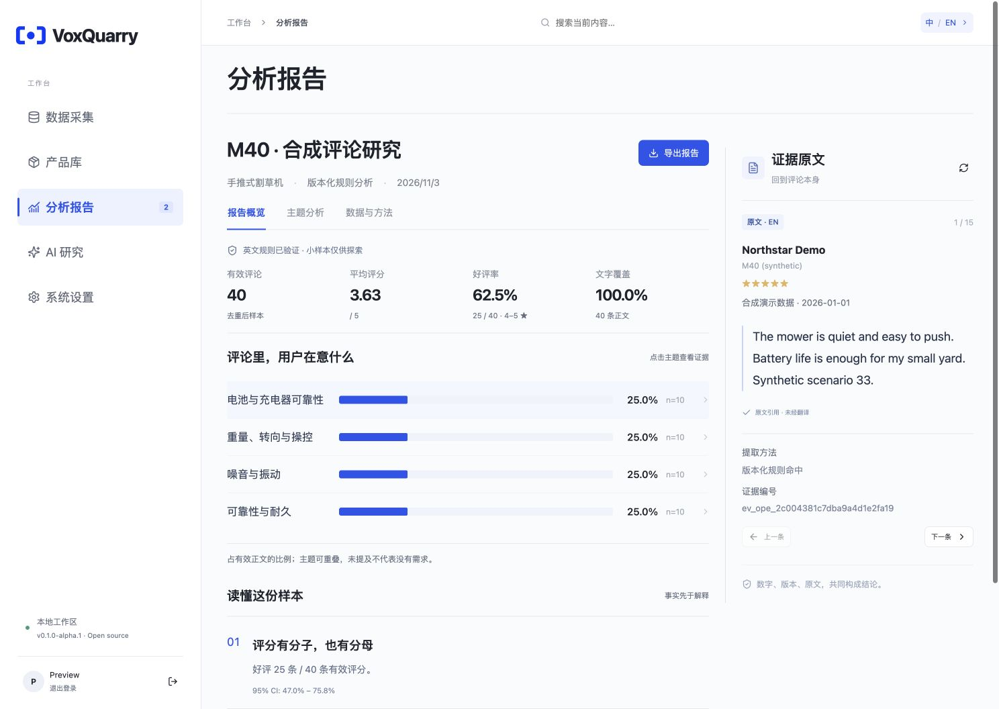

<p align="center"></p>

# VoxQuarry

**从评论到证据。** 一个可自托管的中英文工作台，串联评论采集、产品资料、可复核分析报告，以及带来源引用的 AI 研究。

[English](README.md) · [架构](docs/architecture.md) · [配置](docs/configuration.md) · [首发说明](docs/releases/v0.1.0-alpha.1.md)



VoxQuarry 把分母、来源版本和评论原文放在结论旁边。确定性报告不需要模型密钥；AI 研究使用你配置的模型，保存答案前重新核对引用来源。

## 包含哪些功能

| 功能 | 首发能力 |
|---|---|
| 数据采集 | 多来源适配器，Walmart / Home Depot 有界小样本采集，JSON 导入、尝试历史、去重和完整性记录 |
| 产品库 | 品类、品牌、型号、结构化规格、来源证据、审核状态及 API |
| 分析报告 | 版本化英文规则，带分子分母的指标，主题分析、固定快照、原文证据及 Markdown / JSON 导出 |
| AI 研究 | 私有会话、报告发现、工具调用研究、Markdown 回答、可查看的引用与步骤；自带模型 |
| 系统设置 | 本地账号、语言切换、模型与执行器状态、可重复载入的合成演示 |

界面、文档和报告摘要提供简体中文与英文。研究回答语言可以独立设置，问题中的明确语言要求优先。切换界面不会翻译证据原文，也不会重写历史回答。

**Alpha 范围：**确定性规则已验证的原评语言为英文。中文原评可以导入保存，但不能直接进入英文规则报告。首批规则主要覆盖 OPE 和相关产品品类，不是适用于所有行业的通用情感模型。小样本标记为探索性分析；部分来源不会被描述为全站总体。

## 本地启动

需要 Python 3.11、Node.js 22、npm、Git，以及 macOS 或 Linux。完整应用包含本地后端，不能只靠静态网页托管运行。

```sh
git clone https://github.com/ankeyao-lab/voxquarry.git
cd voxquarry
make install
make start
```

打开 **http://127.0.0.1:18763**，创建首个管理员。在“分析报告”点击“载入合成演示”，即可生成一个虚构产品、40 条虚构英文评论及一份报告，无需任何模型账号。上述 clone 地址在首次 GitHub 发布后生效；使用源代码压缩包时，解压后执行同样的 `make` 命令。

需要通过浏览器采集时，再安装浏览器：

```sh
.venv/bin/python -m patchright install chromium
```

Linux 还可能需要浏览器系统库。导入、产品库和确定性报告不依赖浏览器。详见[配置与采集说明](docs/configuration.md)。

## 连接自己的模型

在服务端同时设置以下变量，再重启应用：

```sh
export VOXQUARRY_LLM_API_KEY='你的密钥'
export VOXQUARRY_LLM_BASE_URL='https://你的模型服务.example/v1'
export VOXQUARRY_LLM_MODEL='实际模型标识'
make start
```

使用支持 Chat Completions、结构化输出稳定的模型。不同服务商存在协议差异，需要在自己的端点验证。密钥仅保存在服务端；模型服务会接收该次研究所需的问题与证据，费用由你的账号承担。[可选隔离执行器](docs/runtime.md)扩展自动采集、附件分析和沙箱执行；普通报告研究不依赖它。

## 数据与验证

- 默认数据目录为 `.runtime/`，已排除在 Git 之外。
- `examples/synthetic-reviews.json` 是可导入的虚构样本，不是真实消费者研究。
- 报告保存来源快照、哈希、计数和证据编号。
- “达到样本上限”不等于“已采集全部源评论”。
- 中英文展示使用同一份规范事实，技术工件保留原始来源文字。

```sh
make check
make release-check
```

检查覆盖计算契约、导入、账号、会话归属、研究工具、沙箱边界和前端构建。测试使用合成数据和模拟模型；执行器测试会使用临时回环端口，不启动 Docker 或调用付费模型。可选图片/PDF 测试依赖分析镜像的库和中文字体。[完整验证状态](docs/validation.md)。

## 开源与参与

采用 Apache-2.0。[许可证](LICENSE)、[第三方声明](THIRD_PARTY_NOTICES.md)、[参与贡献](CONTRIBUTING.md)、[安全问题反馈](SECURITY.md)。

这是一个独立 AI Builder 项目：把产品设计、数据契约、确定性分析、Agent 工具、运行隔离与实际界面放在同一份可检查的实现里。
