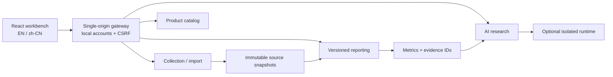

# Architecture / 架构

The default application is one Python process behind one browser origin. The gateway strips caller-supplied identity headers, authenticates a local session, checks capabilities, then signs a fresh identity for internal modules. Products and collected/report data belong to the shared workspace. Research conversations, source attachments and generated files remain scoped to the owning principal.

默认应用为同一来源下的一个 Python 进程。网关去除浏览器伪造的身份头、校验本地会话和能力，再向模块提供签名身份。产品、采集数据与报告属于共享工作区；研究会话、附件及其产出按用户隔离。

| Directory | Responsibility / 职责 |
|---|---|
| `voxquarry/` | Gateway, demo/import, source-language boundary, localized presentation / 集成层 |
| `collector/` | Source adapters, retries, normalized records, validation / 采集与证据 |
| `retail_landscape/` | Products, typed facts, provenance and review state / 产品库 |
| `reporting/` | Rule packs, canonical metrics, immutable report/evidence store / 确定性分析 |
| `agent/` | Research plans, tools, citation checks and per-user state / AI 研究 |
| `account_admin/` | Local identities, password hashing, roles, sessions and audit / 本地身份 |
| `runtime/harness/` | Optional runner, analysis worker, constrained relay and trusted manager / 隔离执行 |
| `web/` | Shared five-module UI / 五模块统一界面 |

## Contracts / 契约

Collection writes normalized artifacts and an explicit completeness statement. Reporting reads an immutable snapshot. Report facts carry source versions and hashes. AI receives versioned tools and facts rather than unrestricted database access; the model is not a permission or metric authority.

采集负责来源与完整性，报告消费固定快照，AI 读取版本化工具和事实。展示语言与规范数字分离。某些内部协议仍保留原有技术命名以维持契约兼容；它们不是公开产品的功能名称。

The optional manager alone owns a dedicated Docker engine socket. Model-facing containers do not inherit the socket, provider key or management credential. The relay exposes bounded capability-authenticated broker paths. Engine identity and immutable image IDs are checked before attempts.

可选执行器只有可信 manager 持有专用 Docker socket。模型容器不持有宿主控制权限或模型密钥；relay 仅提供受能力令牌约束的路径。不要复用部署着其他业务的 Docker 引擎。

## Initial boundaries / 首发边界

A local workspace is the default target, not a multi-tenant SaaS or an enterprise SSO deployment. The optional sandbox is experimental until its dedicated-engine smoke passes on the operator's machine. The project excludes competitive-monitoring modules and contains no organization directory, production database, private research library or inherited private Git history.
